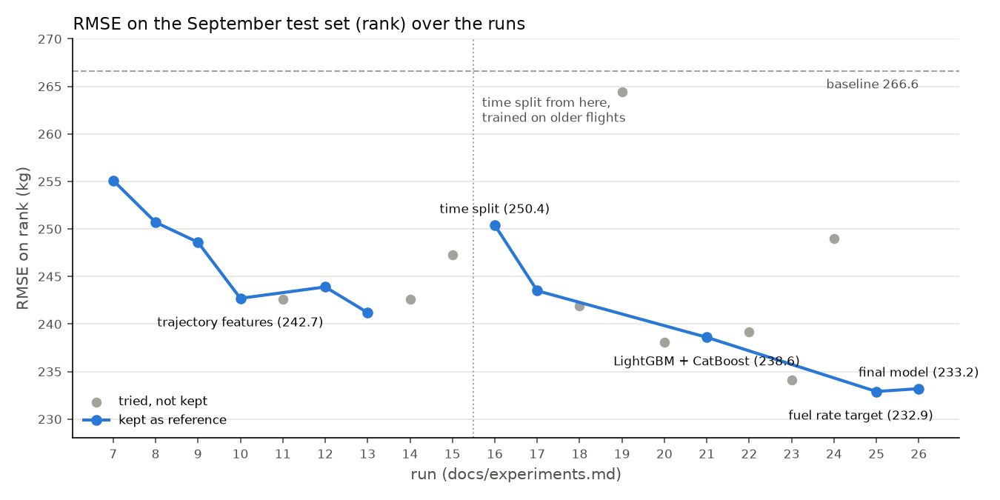

# PRC Data Challenge 2025: fuel burn estimation

The goal is to predict how much fuel an airliner burns over a given window of its flight, using its ADS-B trajectory, the flight list and the airports. It's the 2025 edition of the EUROCONTROL Performance Review Commission data challenge. I did it after the challenge was over, as a learning project, so the scores here are not an official entry.

## Results

RMSE in kg on the two test sets, September (`rank`) and October (`final`). The official ranking used both together.

| Model | rank | final | rank + final |
|---|---|---|---|
| Baseline: median fuel rate of the aircraft type × duration | 266.6 | 249.3 | 256.3 |
| CatBoost on the fuel rate (final model) | 233.2 | 213.7 | 221.6 |

I fixed the final model before looking at `final`, and it was trained on `train` only. With 221.6 kg it would have been 6th out of the 19 teams in the [official final ranking](https://ansperformance.eu/study/data-challenge/dc2025/outcome.html) (the winner got 200.83). The baseline alone would have been 10th.

The comparison is a bit in my favour though. The teams didn't know the fuel of `rank` or `final` during the challenge, while I used `rank` to check my choices along the way (never to train). I could also read how the teams worked, and the climb mass idea below comes from there.



Blue runs became the new reference, grey ones were tried and dropped. The jump at run #16 is when I switched to a time-based validation: training keeps the same number of flights, but only up to mid-July, so further from September. The figure is made by `scripts/plot_scores.py` from the experiment log.

A good part of the error comes from a few flights with a fuel rate far off for their aircraft type. We only see that from their fuel, which isn't known when predicting, so the model can't do much about them. Without them, and without a few flights whose windows fall far outside the flight time, the error on validation goes from 162.6 to 134.4 kg.

## Approach

Every run is in [`docs/experiments.md`](docs/experiments.md), and [`docs/roadmap.md`](docs/roadmap.md) explains in which order things were tried and why.

I started by exploring every table ([`docs/exploration.md`](docs/exploration.md)). The target is the fuel burnt over a time window, about 40% of the windows have almost no trajectory points, and around 2% of the flights have a fuel rate way out of range for their type.

After a baseline, LightGBM on the duration, the aircraft type and where the window sits in the flight already did better. Then came features per window computed in BigQuery (altitudes, speeds, mach, distance flown), with impossible values set to NaN using thresholds taken from gaps in the data.

Tuning on a random validation split made the score on `rank` worse, probably because validation flights had very close flights (same aircraft, route, week) in training. So I switched to a time split, keeping the last 20% of flights for validation, like the test sets come after train. With it, validation and `rank` ranked the LightGBM configurations almost the same way (Spearman 0.94).

The last real gain came from CatBoost, and mostly from predicting the fuel rate (kg/s) instead of the fuel, then multiplying by the duration. A tree can't multiply two columns, so this way the model only has to learn what changes the rate. Against the average of LightGBM and CatBoost, validation went from 170.0 to 162.6 kg and `rank` from 238.6 to 232.9.

Quite a few ideas didn't work, and each one was measured before I dropped it. The OpenAP fuel flow correlated well with the fuel, but only through the duration and the aircraft size, which the model already had. Estimating the aircraft mass from the climb (energy balance with OpenAP thrust and drag) gave mostly noise: on the A359, flights of the same route got anything between ~140 and ~210 t, with no link to their fuel rate. My guess is that groundspeed mixes in the wind and the thrust really used is unknown. Filling the windows without trajectory wasn't worth it either, they are long windows and already the best predicted relative to their fuel. I also tried the wind from ERA5 on one week, and it had almost no link with the error, probably because airliners cruise at a fixed mach, so wind changes the distance flown more than the fuel burnt per hour. XGBoost, weighting windows by their duration, a single filled-in speed column and re-tuning CatBoost on the rate didn't help either.

## Running it

Requirements: [uv](https://docs.astral.sh/uv/), and Google Cloud access for the data (see [`docs/stack/04-gcloud-auth.md`](docs/stack/04-gcloud-auth.md)).

```bash
git clone git@github.com:MalronClem/PRC_data_challenge_2025.git
cd PRC_data_challenge_2025
uv sync                      # create .venv from uv.lock
uv run pre-commit install    # enable git hooks
uv run nbstripout --install  # strip notebook outputs from commits (local git config)
```

To train the final model on all of train and score it on `rank` and `final`:

```bash
uv run python -m prc_fuel.run --drop avg_vertical_rate openap_fuel airspeed_kt --model catboost --target rate --final
```

Without `--final`, it trains on the time split and prints the RMSE on validation, on validation without the outlier flights, and on `rank`. You can also change the model (`--model lightgbm`, `xgboost`, `catboost` or `blend`), the target (`--target fuel` or `rate`), the split (`--split time` or `random`) and the features (`--features`, `--drop`). The first run queries BigQuery and keeps a copy of the data in `data/`.

The code is split into small modules in `src/prc_fuel/`.

| Module | Does |
|---|---|
| `load.py` | queries fuel windows with flight, airport and trajectory info (`train`, `rank` or `final`), cached as parquet |
| `split.py` | random or time-based split by flight |
| `clean.py` | masks impossible feature values, and drops from training the flights with windows far outside the flight time (flights with an odd fuel rate stay, it scores better) |
| `features.py` | one function per feature, and `build_features` to pick some |
| `train.py` | LightGBM, XGBoost and CatBoost behind one `Model` class, the blend, and the fuel rate target |
| `evaluate.py` | RMSE |
| `run.py` | command line entry, puts everything together |

## Project layout

```
src/prc_fuel/          project package
notebooks/             exploration and every experiment behind the docs
scripts/               figure of the scores over the runs
sql/                   BigQuery scripts (external tables on gs://prc2025/raw)
docs/exploration.md    data exploration findings
docs/experiments.md    experiment log: data, features, model, parameters, scores
docs/roadmap.md        what was done, in which order, and why
docs/stack/            technical choices and setup of each tool
```

## Data and references

The data is not stored in this repository. It is published under CC BY 4.0:

- Sun, J., Spinielli, E., & Strohmeier, M. (2026). *Aircraft Fuel Burn Estimation: The EUROCONTROL PRC 2025 Data Challenge*. Journal of Open Aviation Science. https://doi.org/10.59490/joas.2026.8750
- Dataset: https://doi.org/10.5281/zenodo.19184661

## License

Code released under the MIT License (see `LICENSE`).
